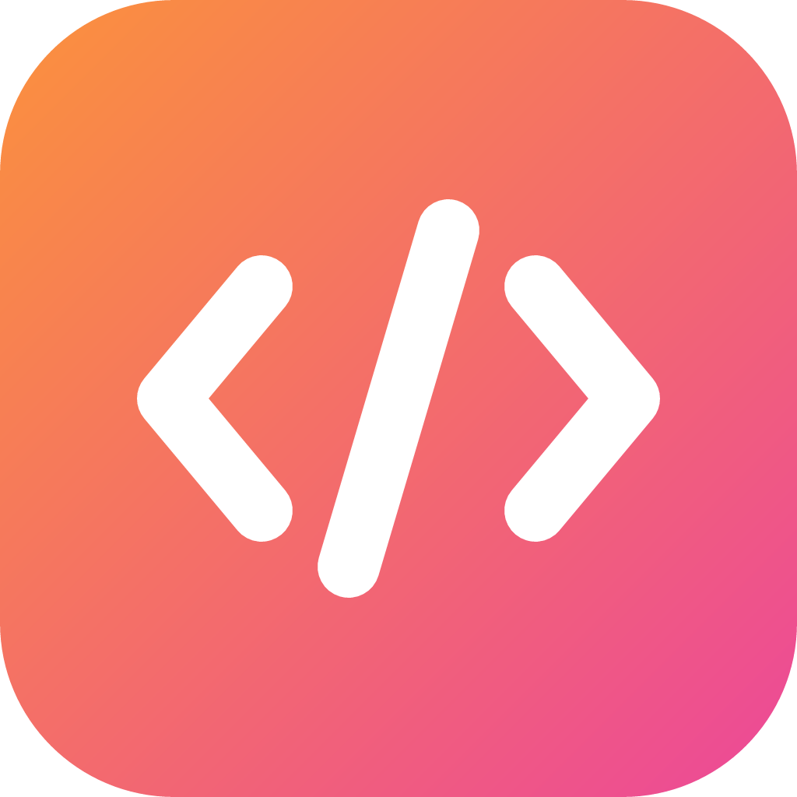
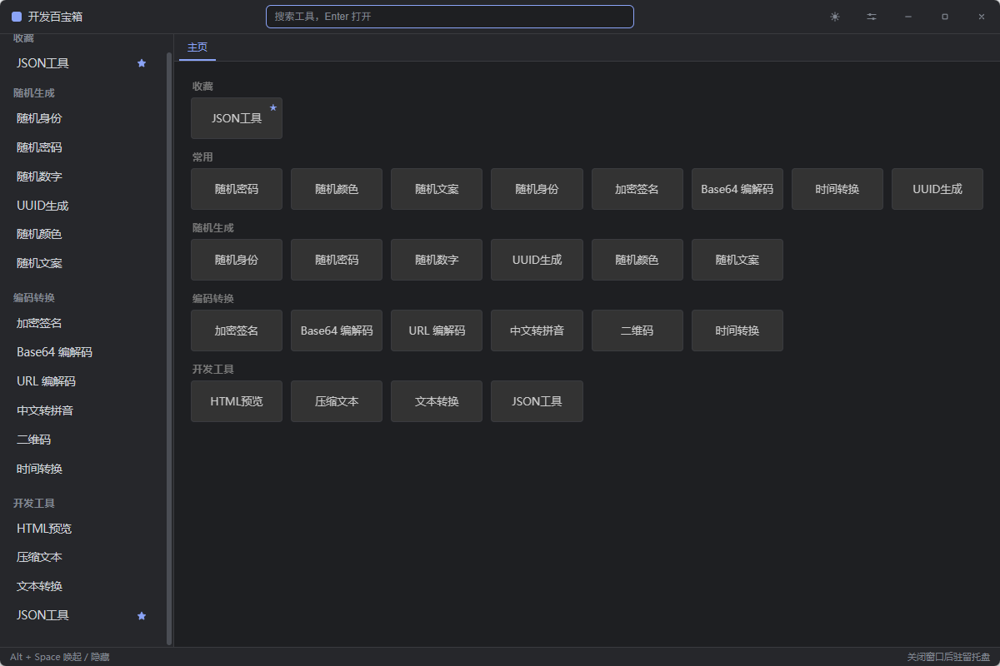

<div align="center">



# 开发百宝箱 · DevBox

一款轻量的 Windows 桌面开发者工具箱，16 个常用小工具，安装包仅几 MB。

**Tauri 2 · Vue 3 · Element Plus**



</div>

## ✨ 特性

- **轻量**：渲染层使用系统自带的 WebView2，不打包 Chromium，安装包只有几 MB
- **16 个常用工具**：随机生成、编码转换、开发工具三大类，详见下方[工具清单](#-工具清单)
- **全局快捷键**：`Alt + Space` 随时唤起/隐藏；支持自定义任意数量的组合键
- **后台快捷动作**：随机密码/UUID/颜色/文案/数字可绑定快捷键，**不打开窗口直接复制或复制并粘贴**到当前应用
- **配置持久化**：每个工具的配置（如密码长度、字符集）自动保存，快捷键生成与页面所见即所得
- **收藏与多标签**：侧边栏星标收藏，标签页多开、右键批量关闭，主页常驻
- **二维码截图识别**：一键调起系统截图框选，自动解码到剪贴板
- **明暗双主题**：跟随系统 / 手动切换，全部界面适配暗色
- **驻留托盘**：关闭窗口收进托盘，可选开机自启

## 📦 下载安装

前往 [Releases](../../releases) 页面下载最新的 `DevBox_x.y.z_x64-setup.exe`，双击安装即可。

> 系统要求：Windows 10 1809+（需要 WebView2 运行时，Win11 自带；没有时安装器会自动下载）。
> 安装包未做代码签名，首次运行如遇 SmartScreen 提示，选择「更多信息 → 仍要运行」。

## 🛠 工具清单

| 分类 | 工具 |
|---|---|
| 随机生成 | 随机身份 · 随机密码 · 随机数字 · UUID 生成 · 随机颜色 · 随机文案（古诗词 / 一言） |
| 编码转换 | 加密签名 · Base64 编解码 · URL 编解码 · 中文转拼音 · 二维码（生成 / 解码） · 时间转换 |
| 开发工具 | HTML 预览 · 压缩文本 · 文本转换 · JSON 工具 |

## ⌨️ 快捷键

| 动作 | 默认 | 说明 |
|---|---|---|
| 唤起 / 隐藏窗口 | `Alt + Space` | 前台时收起到托盘，否则唤起并聚焦搜索框 |
| 打开工具 / 复制结果 / 复制并粘贴 | 自定义 | 设置页中为每个工具录制，录制方式：点输入框按下组合键，退格清空 |
| 打开设置 | `Ctrl + ,` | 应用内快捷键 |

## 🚀 本地开发

环境要求：[Node.js](https://nodejs.org) 18+、[Rust](https://rustup.rs)（MSVC 工具链）、WebView2 运行时。

```bash
npm install            # 安装前端依赖
npm run tauri dev      # 开发模式（热更新）
npm run tauri build    # 打包，产物在 src-tauri/target/release/bundle/nsis/
npx tauri icon app-icon.png   # 修改 design/logo.svg 后重新生成全套应用图标
```

## 📁 目录结构

```
devbox-app/
├── src/
│   ├── App.vue                 # 标签页状态 + 全局事件订阅
│   ├── host/index.ts           # 系统能力层（剪贴板 / 通知 / 存储 / 窗口）
│   ├── toolbox/
│   │   ├── DesktopLayout.vue   # 标题栏 / 侧边栏 / 标签条 / 状态栏
│   │   ├── tools.ts            # 工具注册表
│   │   ├── toolSettings.ts     # 工具配置 Schema（页面与快捷键共用同一份）
│   │   ├── quickActions.ts     # 快捷键后台动作（复制 / 复制并粘贴）
│   │   └── ...
│   └── tools/                  # 16 个工具组件
├── docs/                       # 规范文档与截图
└── src-tauri/                  # Rust 壳：托盘、全局快捷键、自动发布工作流
```

## 🏗 架构约定

- 工具组件只通过 `src/host/index.ts` 调用系统能力，不直接 import Tauri API
- 工具配置在 `toolSettings.ts` 中声明 Schema，页面 UI 与快捷键动作共用同一份响应式配置
- 新增工具请遵循 `.agents/skills/devbox-tool/SKILL.md` 中的创建规范与验收清单

## 📄 License

暂未设置，发布前请添加（如 MIT）。
